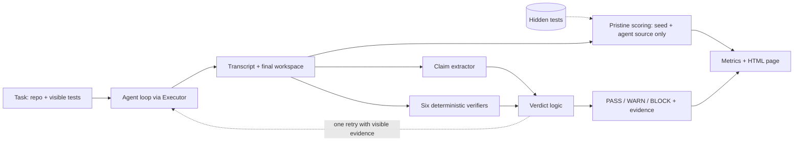

# TrustButVerify (TBV)

When a coding agent says "done", what evidence should a developer see before trusting it?

TBV is a gate that checks an agent's claims ("tests pass", "bug fixed", "file created") against
deterministic evidence: a clean re-run of the tests, build and lint results, the diff, the agent's own
command trace, and tamper detection (edited tests, skip markers, hardcoding). It ships with a task suite
that has hidden tests, so we can measure how often agents claim completion falsely.

All results are phrased as: "on this task suite with these agent configurations".

## Try it now (free, offline, about 30 seconds)

  uv run tbv demo

It runs 13 scripted "agents" (honest, lazy, cheating) through the real gate, prints the terminal
reports, writes PR-comment Markdown and JSON for every run, and builds `demo_out/report.html`, the
results page. Everything it produces is stamped SYNTHETIC: it demonstrates the interface, it is not data.

## Interfaces

  Terminal report   `tbv verify ...` (symbols AND words, exit 0 PASS / 2 WARN / 1 BLOCK)
  PR comment        Markdown under 4,000 characters with collapsible evidence
  JSON report       versioned schema `tbv.gate_report/1`
  Results page      `tbv analyze` writes a self-contained HTML page (works offline, dark mode)
  Docs page         `make docs-html` renders these docs as one readable HTML file

## Status (honest)

Code complete and tested with scripted agents (113 tests run offline; 23 more run only with Docker): task format and validator, pristine scoring,
sandbox executor interface, agent loop and transcripts, claim extraction, six verifiers, verdict logic,
reports, retry loop, resumable experiment runner with the TEST-split guard, metrics, HTML page.

Live wiring (`tbv models`, `tbv run`, `tbv experiment`, with a token-aware quota limiter and a dry-run
projection) is written and its orchestration is tested with fakes. CI is green on GitHub.
Written but NOT yet run against the real thing: the Docker executor and its security tests, the
Gemini adapter, the devcontainer. Run `make docker-tests` in your Codespace first.

Not done: the full suite (16 validated tasks exist; target 30 to 40),
difficulty calibration, manual task review, real experiment results, red-team report, claim-labeling
tool, developer study. There are NO results yet; do not quote any number from this repo.

## Quick start (GitHub Codespace, or Linux/macOS with Docker)

  1. make setup
  2. make test lint
  3. make demo
  4. make docker-tests     (needs Docker: builds the sandbox image, runs the security tests)
  5. uv run tbv doctor

No make? `uv sync --all-extras`, `uv run pytest -q`, `uv run ruff check .`, `uv run mypy tbv`.

## Commands

  tbv demo                         offline demo with scripted agents (SYNTHETIC)
  tbv doctor                       check Docker, configs, keys, pre-registration
  tbv suite expand|validate|split|stats    build, validate, split and count tasks
  tbv sandbox build                build the sandbox image
  tbv verify --transcript T --workspace W --task-dir D     run the gate
  tbv analyze                      rebuild the results page from results.sqlite
  tbv models                       list model ids your API key can call
  tbv run --agent A --task T       one live run (needs Docker, a key, model ids in config)
  tbv experiment --matrix M [--dry-run] [--final]   resumable experiment; dry run projects the cost

## Exit codes

  0 PASS    1 BLOCK    2 WARN    (verdicts of `tbv verify`)
  3 not implemented   4 task validation failed   64 usage error   69 Docker/environment   70 internal
Usage errors and crashes deliberately do not reuse 1 or 2 (docs/DECISIONS.md D-001).

## Architecture

The dotted hidden-tests path is the point: hidden tests reach only the scorer, never the agent, the gate,
the verifiers or the retry message (tests prove each of those).

## Layout

  tbv/        core, suite, sandbox, agents, gate, experiment, analysis, cli.py, demo.py, scenarios.py
  suite/      specs/ (compact task specs), tasks/ (expanded), splits.yaml (frozen once created)
  config/     agents.yaml, gate.yaml, pricing.yaml, prompts/
  docs/       PRD, PREREG, METRICS, DECISIONS, ASSUMPTIONS, DATA_CARD, SECURITY
  infra/      Dockerfile.sandbox        scripts/   build_docs.py

## Rules this repo lives by

1. Hidden tests never reach the agent or the gate.
2. Verdicts come from deterministic evidence, never from a model's opinion.
3. Model-written code runs only inside the Docker sandbox.
4. Tune on DEV; report on TEST once.
5. Every number is generated by code. None are typed by hand.
